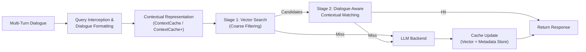
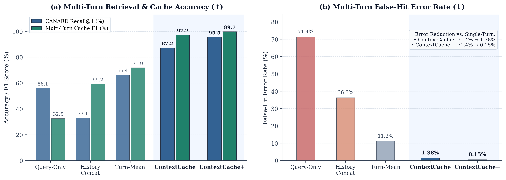
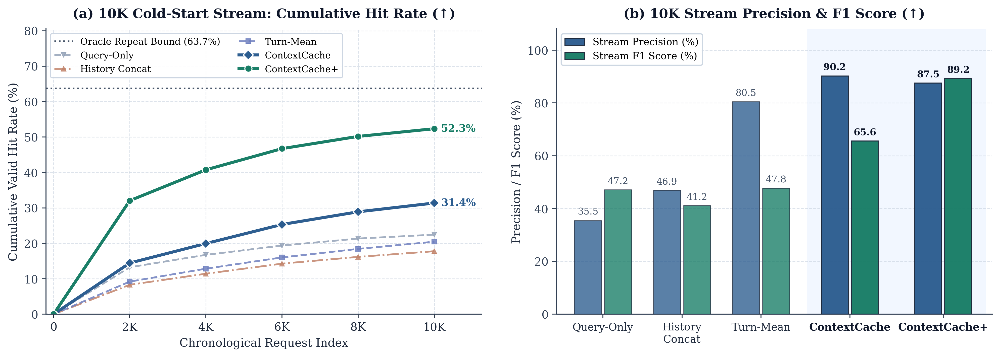

# ContextCache: Context-Aware Semantic Cache for Multi-Turn Queries in Large Language Models

[%3A_5391--5394-blue)](https://doi.org/10.14778/3750601.3750679)
[](https://youtu.be/R3NByaQS7Ws)
[](https://www.python.org/)
[](LICENSE)

## Demo

[https://youtu.be/R3NByaQS7Ws](https://youtu.be/R3NByaQS7Ws)

## 🚀 What is ContextCache?

Large language models (LLMs) like ChatGPT enable powerful applications, but scaling them introduces significant costs and latency from repeated API calls. While solutions like GPTCache have emerged to cache LLM responses through semantic matching, existing approaches primarily focus on individual queries without considering conversational context.

This limitation becomes particularly problematic in multi-turn dialogues, where similar queries in different contexts may trigger incorrect cache hits, while naive history concatenation or turn averaging dilutes current query intent. To solve this, we present **ContextCache**, a context-aware semantic caching system designed for conversational AI (*PVLDB 2025*), together with **ContextCache+**, an enhanced LoRA-adapted extension built on modern LLM-based embedding backbones.

**Key capabilities:**

- **Two-Stage Retrieval Architecture**: Combines fast vector candidate filtering with dialogue-aware contextual verification.
- **ContextCache (Attention-Based Turn Integration)**: Integrates current and historical turn representations via positional awareness and multi-head attention while reusing cached turn embeddings.
- **ContextCache+ (LoRA-Adapted Backbone)**: Extends ContextCache onto modern causal embedding models (`Qwen3-Embedding`) via parameter-efficient LoRA adaptation and session prefix KV-cache reuse for stronger fine-grained multi-turn disambiguation.
- **End-to-End Acceleration over LLM Inference**: Delivers substantial precision and recall gains over single-turn and heuristic multi-turn baselines while bypassing multi-second autoregressive LLM decoding on cache hits (~10× end-to-end response speedup).

---

## Architecture Overview



1. **Query Interception & Dialogue Representation**: Parses OpenAI-compatible `messages` or multi-turn `(context, prompt)` inputs within a sliding conversation window.
2. **Contextual Encoding**: Produces context-aware embeddings using either **ContextCache** (`backend="contextcache"`, lightweight attention integration over reusable per-turn embeddings) or **ContextCache+** (`backend="contextcache+"`, LoRA-adapted embedding backbone with prefix KV reuse).
3. **Two-Stage Dynamic Retrieval**: Performs coarse vector search (`HNSW` / `FAISS`) followed by exact contextual similarity matching under static or online adaptive policies.
4. **Dual-Storage Management**: Stores contextual vectors alongside structured `(query, response)` metadata (`SQLite` / in-memory) and configurable cache eviction (`LRU` / `FIFO`).

---

## Installation

```bash
git clone https://github.com/uYanJX/ContextCache.git
cd ContextCache
pip install -e .
```

---

## Quickstart

### 1. Multi-Turn Caching & Cross-Context Disambiguation (Runnable Offline)

Both `backend="contextcache"` and `backend="contextcache+"` work out of the box with pretrained weights included in `checkpoints/`:

```python
from vcache import (
    VCache,
    VCacheConfig,
    ContextAwareEmbeddingEngine,
    PassthroughInferenceEngine,
    BenchmarkStaticDecisionPolicy,
)

# Choose "contextcache" (attention-based turn integration) or "contextcache+" (LoRA-adapted backbone)
engine = ContextAwareEmbeddingEngine(backend="contextcache+")
llm = PassthroughInferenceEngine()

config = VCacheConfig(
    inference_engine=llm,
    embedding_engine=engine,
    use_two_stage_cache=True,
)
cache = VCache(
    config=config,
    policy=BenchmarkStaticDecisionPolicy(threshold=engine.recommended_threshold),
)

# Seed cache: conversation about Apache Kafka
llm.set_next_response("Apache Kafka provides distributed event streaming and partitioned logs.")
hit1, ans1, _, _ = cache.infer_with_cache_info(
    messages=[
        {"role": "user", "content": "What is Apache Kafka?"},
        {"role": "assistant", "content": "Apache Kafka is a distributed event streaming platform."},
        {"role": "user", "content": "What are its key features?"},
    ]
)
assert hit1 is False  # Initial miss populates cache

# Scenario 1 — Cache Hit: paraphrased follow-up in an equivalent Kafka context
hit2, ans2, _, _ = cache.infer_with_cache_info(
    messages=[
        {"role": "user", "content": "Can you briefly introduce Apache Kafka?"},
        {"role": "assistant", "content": "It is a distributed event streaming platform."},
        {"role": "user", "content": "Could you list its main features and capabilities?"},
    ]
)
assert hit2 is True and ans2 == ans1

# Scenario 2 — Cache Miss: identical surface query under a different topic context
llm.set_next_response("Kubernetes provides container orchestration and automated scaling.")
hit3, ans3, _, _ = cache.infer_with_cache_info(
    messages=[
        {"role": "user", "content": "What is Kubernetes?"},
        {"role": "assistant", "content": "Kubernetes is a container orchestration system."},
        {"role": "user", "content": "What are its key features?"},
    ]
)
assert hit3 is False  # Avoids cross-context false cache hit
```

### 2. Using with OpenAI-Compatible LLM Backends

```python
from vcache import (
    VCache,
    VCacheConfig,
    ContextAwareEmbeddingEngine,
    OpenAIInferenceEngine,
    BenchmarkStaticDecisionPolicy,
)

engine = ContextAwareEmbeddingEngine(backend="contextcache+")
config = VCacheConfig(
    inference_engine=OpenAIInferenceEngine(model_name="gpt-4o-mini"),
    embedding_engine=engine,
    use_two_stage_cache=True,
)
cache = VCache(
    config=config,
    policy=BenchmarkStaticDecisionPolicy(threshold=engine.recommended_threshold),
)

reply = cache.infer(
    messages=[
        {"role": "user", "content": "What is PostgreSQL?"},
        {"role": "assistant", "content": "PostgreSQL is an open-source relational database."},
        {"role": "user", "content": "How does MVCC work in it?"},
    ]
)
```

---

## Experimental Evaluation

We evaluate ContextCache and ContextCache+ built on `Qwen3-Embedding-0.6B` across open-domain conversational question answering (**CANARD**) and multi-session chronological streaming workloads:

### 1. Multi-Turn Retrieval (`CANARD`) & Conversational Cache Accuracy



| Method | CANARD R@1 | CANARD MRR@10 | Cache Precision | Cache Recall | Cache F1 | False-Hit Error ↓ |
| :--- | :---: | :---: | :---: | :---: | :---: | :---: |
| `Query-Only` (Single-Turn) | `56.08%` | `63.19%` | `20.75%` | `75.31%` | `32.53%` | `71.36%` |
| `History Concat` | `33.08%` | `53.14%` | `51.23%` | `70.14%` | `59.22%` | `36.29%` |
| `Turn-Mean` (Averaging) | `66.42%` | `75.91%` | `81.09%` | `64.54%` | `71.87%` | `11.18%` |
| **`ContextCache`** | **`87.25%`** | **`90.99%`** | **`98.29%`** | **`96.10%`** | **`97.19%`** | **`1.38%`** |
| **`ContextCache+` (LoRA)** | **`95.50%`** | **`96.95%`** | **`99.82%`** | **`99.63%`** | **`99.72%`** | **`0.15%`** |

### 2. 10,000-Request Cold-Start Chronological Stream



| Method | Valid Hit Rate | Precision | Recall | F1 Score | `LRU(2000)` Hit Rate |
| :--- | :---: | :---: | :---: | :---: | :---: |
| `Query-Only` (Single-Turn) | `22.45%` | `35.51%` | `70.18%` | `47.16%` | `20.86%` |
| `History Concat` | `17.78%` | `46.95%` | `36.68%` | `41.19%` | `13.58%` |
| `Turn-Mean` (Averaging) | `20.46%` | `80.49%` | `33.96%` | `47.77%` | `13.52%` |
| **`ContextCache`** | **`31.38%`** | **`90.22%`** | **`51.49%`** | **`65.57%`** | **`22.98%`** |
| **`ContextCache+` (LoRA)** | **`52.35%`** | **`87.54%`** | **`91.00%`** | **`89.24%`** | **`49.09%`** |

---

## Running Tests & Benchmarks

```bash
# Run end-to-end unit tests
pytest tests/test_context_cache.py -v

# Run 10,000-request chronological stream evaluation
python scripts/evaluate_chronological_10k.py
```

---

## Repository Structure

```text
ContextCache/
├── configs/             # Default model and threshold configuration
├── checkpoints/         # Pretrained ContextCache & ContextCache+ weights
├── data/                # CANARD test split & 10,000-request chronological benchmark
├── vcache/
│   ├── context/         # ContextCache & ContextCache+ dialogue modeling & retrieval
│   ├── inference_engine/# OpenAI, vLLM, LangChain & offline inference backends
│   ├── vcache_core/     # Vector DBs (FAISS, HNSW, Chroma), SQLite store & eviction
│   └── vcache_policy/   # Static & adaptive cache decision policies
├── scripts/             # Model training & benchmark evaluation scripts
├── tests/               # End-to-end multi-turn caching unit tests
└── results/             # Benchmark figures & summary tables
```

---

## Citation

```bibtex
@article{yan2025contextcache,
  author    = {Yan, Jianxin and Ni, Wangze and Chen, Lei and Lin, Xuemin and Cheng, Peng and Qin, Zhan and Ren, Kui},
  title     = {ContextCache: Context-Aware Semantic Cache for Multi-Turn Queries in Large Language Models},
  journal   = {Proceedings of the VLDB Endowment},
  volume    = {18},
  number    = {12},
  pages     = {5391--5394},
  year      = {2025},
  doi       = {10.14778/3750601.3750679}
}
```

## Acknowledgments

We gratefully acknowledge the open-source projects that enabled and inspired this work:

- **[vCache](https://github.com/vcache-project/vCache)**: ContextCache is built to be modularly compatible with the vCache storage, eviction, and decision-policy framework.
- **[GPTCache](https://github.com/zilliztech/GPTCache)**: Our context-aware semantic caching design is inspired by GPTCache and optimizes semantic caching for multi-turn conversational workloads.

## License

Released under the [CC BY-NC-ND](LICENSE) license.
